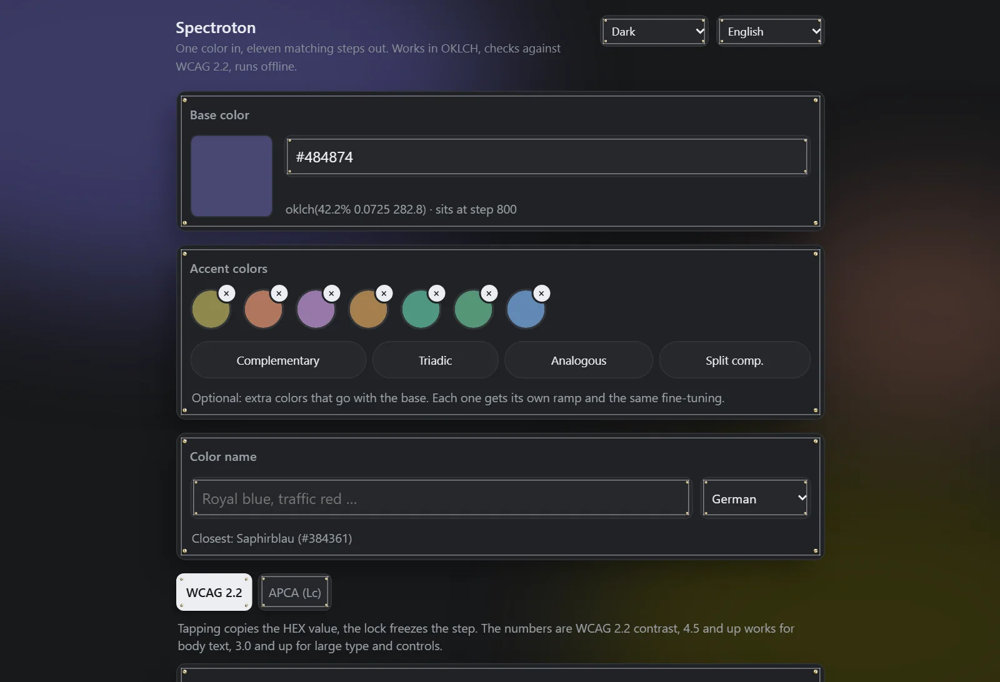
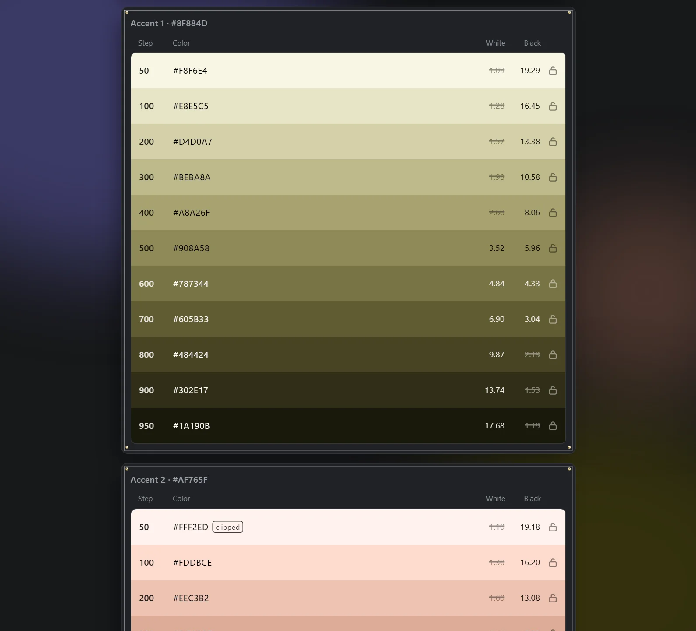
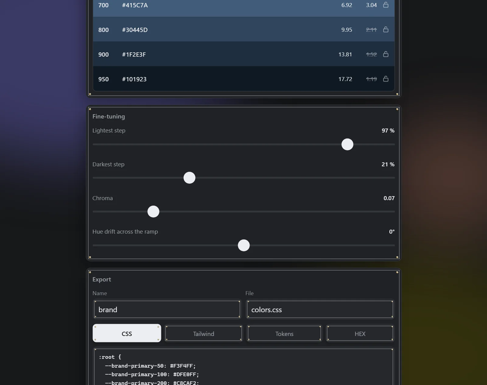
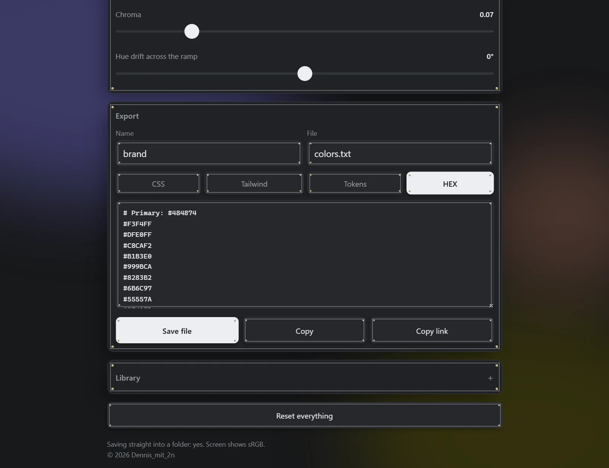

# Spectroton

Eine Farbe rein, elf abgestimmte Stufen raus. Erzeugt perzeptuell gleichmäßige Farbrampen in OKLCH, prüft jede Stufe nach WCAG 2.2 und schreibt das Ergebnis direkt als Datei auf die Platte. Ohne Konto, ohne Server, nach dem ersten Besuch auch ohne Netz.

**Live:** https://dennismit2n.github.io/spectroton/ · [Anleitung und Neuigkeiten](https://dennismit2n.github.io/werkstatt.html#spectroton)

<table>
<tr>
<td align="center" width="50%">
 
Basisfarbe · Akzentfarben · Farbname
</td>
<td align="center" width="50%">
 
Stufen mit Kontrast und Sperren
</td>
</tr>
<tr>
<td align="center" width="50%">
 
Feinjustage
</td>
<td align="center" width="50%">
 
Export · Bibliothek
</td>
</tr>
</table>

## Features

- Basisfarbe per Picker, HEX-Eingabe oder Namenssuche. Die Farbnamen (deutsch, RAL und international) kommen von [color.pizza](https://api.color.pizza), der einzigen fremden Adresse, die die Seite anspricht: Sie bekommt den HEX-Wert der Basisfarbe und deinen Suchbegriff, sonst nichts
- Elf Stufen (50–950) in OKLCH, mit Reglern für Helligkeit, Buntheit und Farbdrift
- Akzentfarben per Farbharmonie dazu (komplementär, triadisch, analog, split-komplementär), jede mit eigener Rampe, gleiche Feinjustage
- WCAG-2.2-Kontrast je Stufe gegen Weiß und Schwarz, wahlweise APCA-Lc-Werte daneben (WCAG-3-Entwurf, nicht normativ)
- Einzelne Stufen sperren: Sie bleiben stehen, wenn Regler oder Basisfarbe sich ändern
- Gamut-Mapping statt hartem Clipping, mit sRGB- und Display-P3-Warnung
- Export als CSS Custom Properties, Tailwind, DTCG-Tokens oder reine HEX-Liste
- Hintergrund folgt live der gewählten Palette
- Darstellung nach Wahl: System, Hell, Dunkel, ein weicheres Dunkel, Hoher Kontrast hell und dunkel, Farbenblind hell und dunkel sowie Umgekehrte Farben
- 14 Sprachen: Deutsch, Englisch, Spanisch, Französisch, Italienisch, Niederländisch, Polnisch, Portugiesisch, Türkisch, Russisch, Hindi, Chinesisch, Japanisch und Koreanisch. Folgt der Sprache deines Browsers, oben umschaltbar. Teils maschinell übersetzt, Korrekturen nehme ich gern an
- Merkt sich Palette und Regler zwischen den Sitzungen; Bibliothek für beliebig viele benannte Paletten, alles im Gerät, kein Konto
- Palette als Link teilen: Der komplette Zustand steckt in der URL, kein Server dazwischen
- Installierbar als PWA, läuft nach dem ersten Besuch auch ohne Netz

## Stack

Statische Seite, keine Abhängigkeiten, keine Build-Kette: `index.html`, dazu `css/style.css` und `js/app.js` mit `js/i18n.js`. Die Farbmathematik (sRGB ⇄ Oklab ⇄ OKLCH, WCAG-Kontrast, Gamut-Mapping) ist selbst implementiert. Bei jedem Deploy die Konstante `VERSION` in `sw.js` hochzählen.

## Lizenz

[MIT](LICENSE).

© 2026 Dennis_mit_2n · Teil der [Werkstatt](https://dennismit2n.github.io/)
